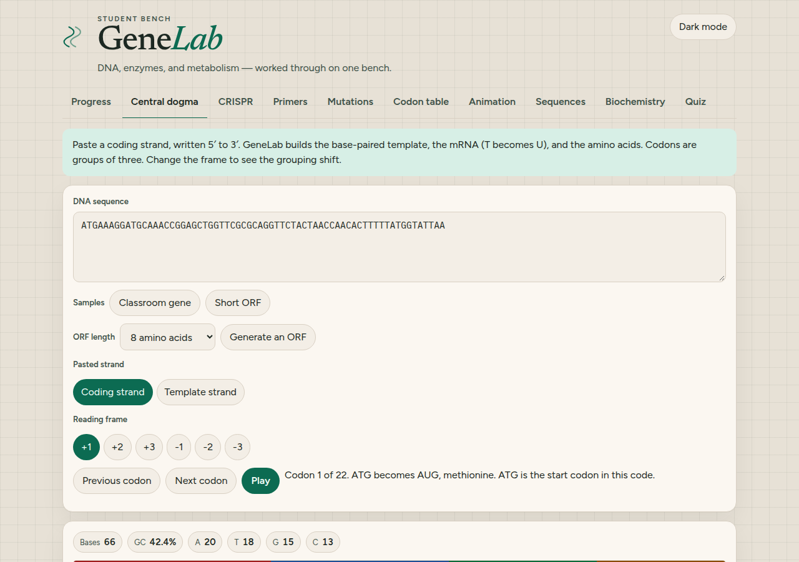
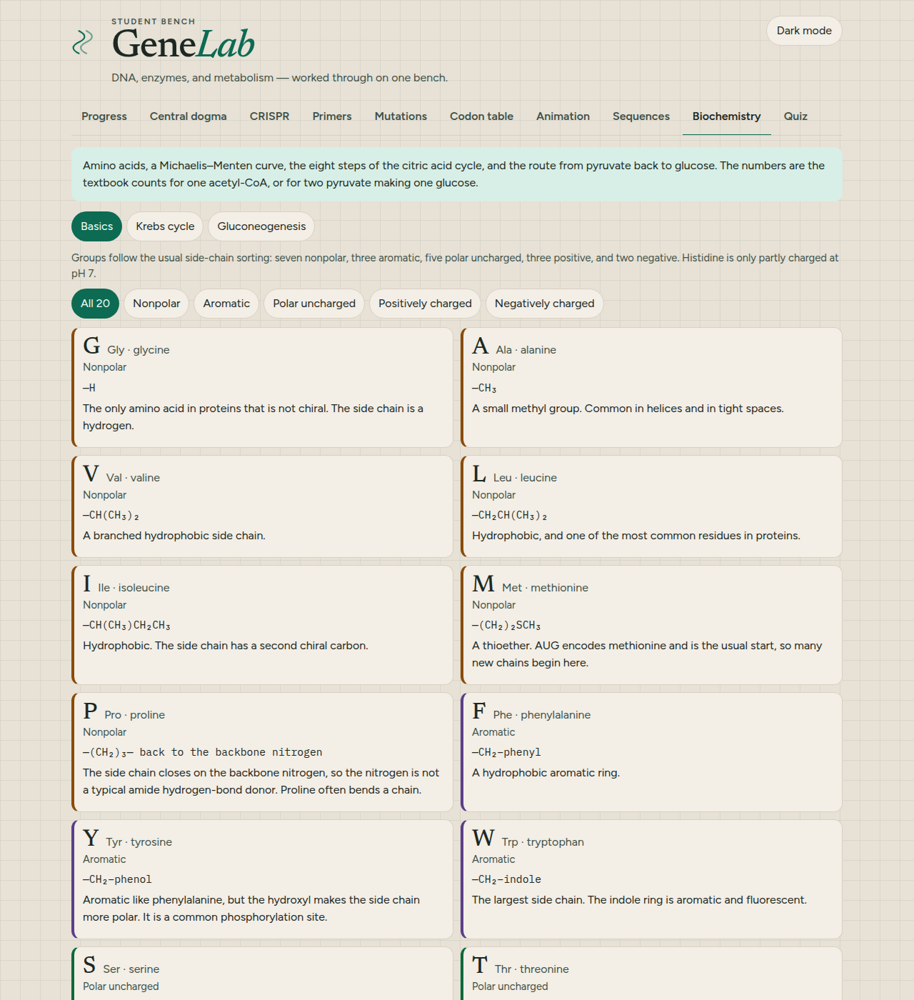
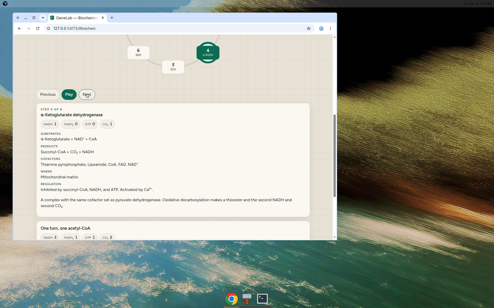
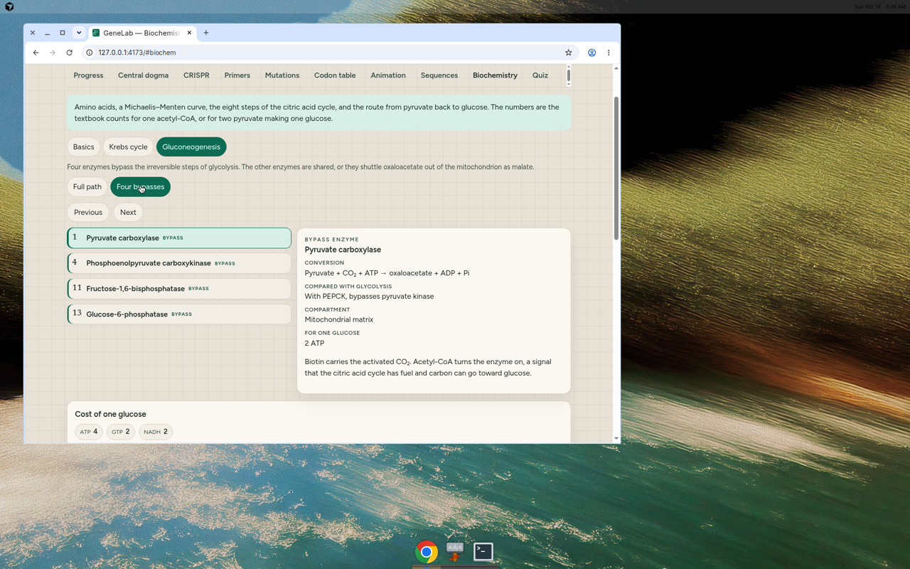

# GeneLab

A static classroom bench for high school and early university biology. DNA stays in the browser. There is no server, no account, and no API key.

**Live demo:** [https://taha080.github.io/genelab-student/](https://taha080.github.io/genelab-student/)

The Pages site updates when `main` is built by GitHub Actions. Until that workflow has run on `main`, the link is the address the site will use.



## Features

- **Progress.** Tools you open, quiz scores, best score, and completion badges stay in `localStorage` on this machine. Reset is two clicks.
- **Central dogma.** Paste or generate DNA, switch coding and template strands, walk codons, and read GC content, reading frames, and the open reading frame.
- **CRISPR guides.** SpCas9 `NGG` sites on both strands, the 20 nucleotides on the 5′ side of the PAM, GC content, and simple sequence flags. This is not an off-target search and not a lab protocol.
- **PCR primers.** Wallace `Tm` and a SantaLucia 1998 nearest-neighbor `Tm`, plus GC, length, 3′ self-complementarity, a simple hairpin check, and the difference between a pair.
- **Mutations.** Substitution, insertion, and deletion, classified as silent, missense, nonsense, stop-loss, frameshift, or an in-frame indel.
- **Codon table.** The standard genetic code as a 4×4×4 grid. Search by codon (`ATG` or `AUG`) or by amino acid. Start and stop are marked.
- **Animation.** A schematic double helix (about 10.5 base pairs per turn), transcription, and translation. Play, pause, and step. If the browser asks for reduced motion, Play stays off and Step still works.
- **Sequence tools.** FASTA parsing, reverse complement, base composition, restriction sites (EcoRI, BamHI, HindIII, NotI, XhoI, and other classroom enzymes), six-frame ORFs, and a short Needleman–Wunsch alignment.
- **Biochemistry.** The 20 amino acids, an interactive Michaelis–Menten plot with a Lineweaver–Burk view, macromolecule overviews, all eight steps of the citric acid cycle, and gluconeogenesis from pyruvate to glucose.
- **Games.** Codon rush, base-pair match, a Krebs-cycle order puzzle, enzyme match, and mutation detective. Scores and high scores stay in the same progress store as the quiz, and a few badges unlock from them.
- **Study room.** A live quiz race over peer-to-peer WebRTC (PeerJS’s public broker only introduces the browsers; there is no API key and this site stores no room), pass-and-play for two to six people on one device, and a challenge link that encodes a quiz seed and a score. Create a room in one tap and share a short code, an invite link, or a QR code drawn in the browser. An invite link asks only for a name (remembered on this device, with a fun default the first time). Join with a code is case-insensitive, and a dropped guest retries a few times. Text chat in the room shows names, colors, times, emoji reactions, and join, leave, and rename notes. Tap your name to change it; the new name is saved on this device and updates the participant list, voice labels, and later chat lines for everyone. Voice is optional and uses the same peers. The microphone starts only after Join voice, for up to six people. Mute, a per-person volume, and a speaking indicator stay in the browser. If the mic is blocked, the quiz continues.
- **Quiz.** Thirty questions with an explanation after each answer. The score is saved in the progress dashboard.







## Run it locally

```bash
npm install
npm test
npm run dev
```

`npm run build` typechecks and writes `dist/`. `npm run preview` serves that folder.

## Science notes

These are the classroom models the code and tests lock in. They are for learning, not for a clinical design.

- **Genetic code.** NCBI standard code (table 1). `ATG` is the start taught here. Stops are `TAA`, `TAG`, and `TGA`. Mitochondrial codes differ, and some bacteria use extra starts. The app does not mark those.
- **Strands.** A coding strand written 5′→3′ matches the mRNA, with T written as U. The template drawn underneath is the complement, so it reads 3′→5′ left to right. Reverse complement is the other strand written 5′→3′.
- **Wallace.** `Tm = 2(A+T) + 4(G+C)`.
- **Nearest neighbor.** SantaLucia 1998, PNAS 95:1460, Table 2, including initiation and the symmetry correction. Salt enters as `0.368 × (N−1) × ln([Na+])`. Defaults are 50 mM Na⁺ and 250 nM oligo. Magnesium is not in the model, so a lab `Tm` can differ.
- **SpCas9.** The guide is the 20 nucleotides immediately 5′ of `NGG` on the strand that carries the PAM. Flags for GC content and poly-T runs are sequence warnings, not an efficiency or off-target score.
- **Michaelis–Menten.** `v = Vmax[S] / (Km + [S])`. At `[S] = Km`, `v` is half of `Vmax`. The Lineweaver–Burk y-intercept is `1/Vmax` and the x-intercept is `−1/Km`.
- **Citric acid cycle.** Per acetyl-CoA: 3 NADH (isocitrate dehydrogenase, α-ketoglutarate dehydrogenase, malate dehydrogenase), 1 enzyme-bound FAD counted as FADH₂ (succinate dehydrogenase, Complex II), 1 GTP (succinyl-CoA synthetase), and 2 CO₂. Those two CO₂ molecules are not the two carbons that just entered. Pyruvate dehydrogenase is the entry step and makes another NADH; it is not one of the eight.
- **Gluconeogenesis.** Two pyruvate to one glucose costs 4 ATP + 2 GTP + 2 NADH. The four bypasses are pyruvate carboxylase, PEPCK, fructose-1,6-bisphosphatase, and glucose-6-phosphatase. The other enzymes are shared with glycolysis or shuttle oxaloacetate out of the mitochondrion as malate.
- **Cori cycle.** Muscle nets 2 ATP turning glucose into two lactate. Liver spends 6 NTP (4 ATP + 2 GTP) to return one glucose. The organism’s net cost is 4 NTP.
- **Games.** Codon rush uses the standard code for 45 seconds. Base-pair match accepts DNA A–T, DNA G–C, RNA A–U, and RNA G–C, and does not treat a DNA adenine as a match for uracil. The Krebs puzzle is the eight cycle enzymes, starting at citrate synthase. Enzyme match uses four cycle enzymes plus pyruvate carboxylase and fructose-1,6-bisphosphatase. Mutation detective classifies edits with the same rules as the mutation tool.
- **Study room scoring.** A correct race answer is worth 60 points, plus up to 40 if it arrives quickly (100 at the instant the question opens, 60 after 10 seconds). A miss is 0. Pass-and-play gives each person different questions, so that total is not a shared challenge. A challenge link replays one shuffled list.

Sample sequences in the app are synthetic. None of them is a natural gene or a pathogen sequence.

## Tests and deployment

GitHub Actions runs `npm test` and `npm run build` on pull requests and on `main`. A push to `main` also uploads `dist/` to GitHub Pages. In the repository settings, Pages needs to use **GitHub Actions** as the source.

## Credits

Created by [Taha Ahsan](https://www.linkedin.com/in/taha-ahsan-832475270/), a computer science graduate in Lahore, Pakistan. [GitHub](https://github.com/taha080)
